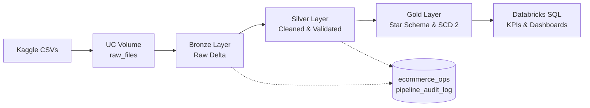

# E-Commerce Databricks Lakehouse

A production-grade Medallion Lakehouse built on **Databricks** (Unity Catalog, Delta Lake, PySpark) using the [Brazilian E-Commerce Public Dataset by Olist](https://www.kaggle.com/datasets/olistbr/brazilian-ecommerce).

---

## Architecture



---

## Medallion Layers

| Layer | Catalog Schema | Description |
|---|---|---|
| **Bronze** | `workspace.ecommerce_bronze` | String-first raw ingestion with `_corrupt_record` capture, metadata lineage (`_source_file`, `_ingested_at`), and idempotent `replaceWhere` batch overwrites. |
| **Silver** | `workspace.ecommerce_silver` | Strongly-typed Delta tables with window deduplication, broadcast referential integrity checks, Delta `MERGE`, and dead-letter quarantine tables (`quarantine_*`). |
| **Gold** | `workspace.ecommerce_gold` | Dimensional star schema with SCD Type 2 customer history and grain-isolated fact tables to eliminate aggregation fan-out. |
| **Ops** | `workspace.ecommerce_ops` | Execution metadata and audit logs (`pipeline_audit_log`) tracking run duration, row counts, and corrupt records. |

---

## Data Model (Gold)

### Dimensions
- `dim_customers` — SCD Type 2 tracking address changes (`customer_sk`, `effective_from`, `effective_to`, `is_current`).
- `dim_products` — Product attributes (`product_sk`, category, dimensions, weight).
- `dim_sellers` — Seller location details (`seller_sk`, city, state).
- `dim_date` — Calendar dimension for temporal analytics.

### Facts
- `fact_orders` — Order grain with pre-calculated totals and delivery performance metrics.
- `fact_order_items` — Line-item grain containing unit pricing and freight values.
- `fact_payments` — Payment transaction grain by payment method and installments.
- `fact_reviews` — Customer review grain with score and response turnaround time.

---

## Project Structure

```text
├── notebooks/                  # Databricks execution notebooks
│   ├── 00_setup_unity_catalog.sql
│   ├── 01_bronze_ingestion.py
│   ├── 02_silver_transformation.py
│   ├── 03_incremental_and_scd.py
│   ├── 04_gold_modelling.py
│   └── 05_pipeline_validation.py
├── src/                        # Reusable PySpark modules
│   ├── config.py               # Schema and catalog configurations
│   ├── ingestion/              # Bronze loaders with schema enforcement
│   ├── quality/                # Deduplication, RI checks, quarantine & merge
│   ├── transformations/        # Silver parsing, SCD2 logic & Gold facts/dims
│   └── monitoring/             # Pipeline audit logging
├── sql/                        # Analytical queries & KPI reports
└── tests/                      # PySpark unit tests (CI with GitHub Actions)
```

---

## How to Run

1. **Upload Source Files**: Upload the 7 Olist CSVs to the Unity Catalog volume:
   ```text
   /Volumes/workspace/ecommerce_bronze/raw_files/
   ```
2. **Initialize Catalog**: Run [00_setup_unity_catalog.sql](file:///d:/DE_Projects/ecommerce-databricks-lakehouse/notebooks/00_setup_unity_catalog.sql) to create schemas, volumes, and audit tables.
3. **Execute Pipeline**: Run notebooks sequentially (or chain via Databricks Workflows with parameter `batch_id`):
   - `01_bronze_ingestion.py`
   - `02_silver_transformation.py`
   - `03_incremental_and_scd.py`
   - `04_gold_modelling.py`
   - `05_pipeline_validation.py`
4. **Query Analytics**: Run [gold_business_metrics.sql](file:///d:/DE_Projects/ecommerce-databricks-lakehouse/sql/gold_business_metrics.sql) for executive KPIs and revenue trends.

---

## Orchestration & Execution (Databricks Jobs)

The pipeline is orchestrated as a parameterized 5-task **Databricks Job** (`ecommerce_lakehouse_pipeline`) on Serverless compute using `batch_id` job parameters and fail-fast task dependencies (`All succeeded`).

- **Total End-to-End Runtime:** `3m 41s` (`01_bronze_ingestion`: `1m 12s` → `02_silver_transformation`: `1m 17s` → `03_incremental_and_scd`: `6.2s` → `04_gold_modelling`: `48s` → `05_pipeline_validation`: `16.3s`)
- **Unity Catalog Lineage:** 26 upstream tables → 24 downstream tables

### Pipeline DAG (Graph View)
[docs/screenshots/databricks_job_dag.png]

### Execution Timeline
[docs/screenshots/databricks_job_timeline.png]