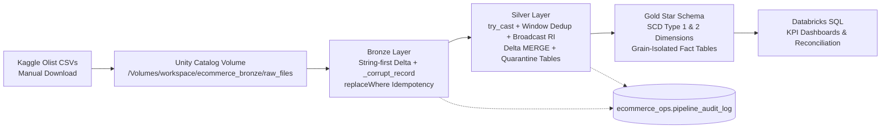

# End-to-End E-Commerce Databricks Lakehouse

Production-oriented Medallion Lakehouse built on **Databricks Free Edition** (Serverless compute, Unity Catalog, Delta Lake) using the [Brazilian E-Commerce Public Dataset by Olist](https://www.kaggle.com/datasets/olistbr/brazilian-ecommerce).

## Architecture

## Key Engineering Highlights
- **Bronze Layer:** Explicit `StringType()` schemas, `multiLine=True` + `escape='"'` (prevented 25 broken multi-line rows in `reviews`), `_metadata.file_path` lineage, `_corrupt_record` capture, and idempotent `replaceWhere` batch overwrites.
- **Silver Layer:** `try_to_timestamp` / `try_cast` (`DECIMAL(10,2)`), composite-key `Window` deduplication (caught 814 shared `review_id`s across orders), `broadcast()` `left_anti`/`left_semi` referential integrity checks, quarantine routing, and `MERGE` with stale-overwrite guards.
- **Incremental & SCD Type 2:** Simulated `batch_2026_11_16` (1 insert, 1 late-arriving update via Deletion Vectors, 1 intra-batch duplicate, 2 quarantined rows) and atomic `merge_key = NULL` SCD Type 2 `MERGE` on `dim_customers` (`sha2` surrogate keys + `row_hash`).
- **Gold Star Schema:** 4 dimensions (`dim_customers` 96,098 | `dim_products` 32,951 | `dim_sellers` 3,095 | `dim_date` 1,461) and 4 grain-isolated facts (`fact_orders` 99,442 | `fact_order_items` 112,650 | `fact_payments` 103,886 | `fact_reviews` 99,224), reconciling `$13,591,643.70` item revenue to the exact cent without fan-out.

## How to Run
1. Download the 7 Olist CSVs manually from Kaggle and upload them to `/Volumes/workspace/ecommerce_bronze/raw_files/`.
2. Run `notebooks/00_setup_unity_catalog.sql`.
3. Run `notebooks/01_bronze_ingestion.py` through `notebooks/05_pipeline_validation.py` (or chain them in Databricks **Jobs & Pipelines** with parameter `batch_id`).
