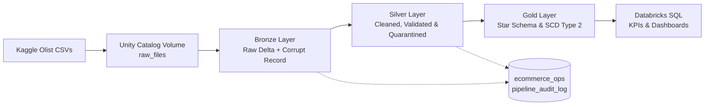
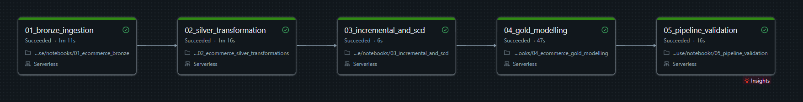
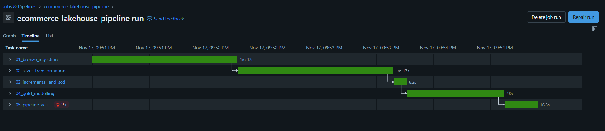

# 🛒 E-Commerce Databricks Lakehouse

> **An end-to-end production-grade Medallion Lakehouse built on Databricks with Delta Lake, Unity Catalog, and PySpark.**

## Overview

This project demonstrates how a production-grade e-commerce analytics platform is built using the Databricks Lakehouse architecture. Raw Brazilian e-commerce data from Olist is ingested into Unity Catalog Volumes, processed through a Medallion architecture (Bronze → Silver → Gold) using Delta Lake, tracked over time with Slowly Changing Dimensions (SCD Type 2), safeguarded with dead-letter quarantine tables and referential integrity checks, orchestrated with Databricks Jobs, and made ready for high-performance BI and SQL analytics.

## Architecture



### Pipeline Flow

1. Kaggle Olist Public Dataset (7 CSVs)
2. Unity Catalog Volume Ingestion (`raw_files`)
3. Bronze Ingestion (Raw Delta + `_corrupt_record` capture + `replaceWhere` idempotency)
4. Silver Cleansing (Safe type casting + Window deduplication)
5. Referential Integrity & Quarantine Routing (`quarantine_*` tables)
6. Incremental & SCD Type 2 Processing (`dim_customers` address history)
7. Gold Star Schema Modeling (Grain-isolated fact tables & dimensional models)
8. Automated Pipeline Validation & Delta Table Optimization (`OPTIMIZE`)
9. Databricks SQL Analytics & Business KPIs

## Technology Stack

| Layer | Technology |
|---|---|
| Source Data | Kaggle Olist Brazilian E-Commerce Dataset |
| Cloud / Platform | Databricks (Serverless Compute) |
| Storage & Governance | Unity Catalog & Volumes |
| Table Format | Delta Lake (ACID, Deletion Vectors, Time Travel) |
| Processing Engine | Apache Spark / PySpark |
| Architecture | Medallion Architecture (Bronze → Silver → Gold) |
| Data Quality | Custom DQ Framework (Quarantine Pattern & Window Dedup) |
| Modeling Technique | Dimensional Star Schema & SCD Type 2 |
| Orchestration | Databricks Workflows (Jobs DAG) |
| Serving / Analytics | Databricks SQL |
| Code Quality & CI/CD | Ruff, Pytest, GitHub Actions |

## Key Features

- **Production Medallion Architecture**: Fully governed lakehouse pipeline transitioning raw CSVs into Bronze, Silver, and Gold Delta tables.
- **Permissive Bronze Ingestion**: Explicit string schemas, multi-line quote handling, `_corrupt_record` isolation, and idempotent batch loading via `replaceWhere`.
- **Silver Data Quality & Quarantine**: Strict type casting (`try_to_timestamp`, `DECIMAL(10,2)`), composite window deduplication, and broadcast referential integrity with dead-letter quarantine routing.
- **Slowly Changing Dimensions (SCD Type 2)**: Tracks customer geographic migrations over time with SHA-256 surrogate keys and atomic Delta `MERGE`.
- **Grain-Isolated Star Schema**: Decoupled fact tables (`fact_orders`, `fact_order_items`, `fact_payments`, `fact_reviews`) eliminating metric inflation and cartesian fan-out.
- **Pipeline Audit & Lineage**: Automated audit logging in `ecommerce_ops.pipeline_audit_log` tracking durations, row counts, and corrupt records across Unity Catalog.
- **End-to-End Validation**: Automated pre-consumption assertions checking row parity, zero duplicate keys, and 100% financial revenue reconciliation.
- **Serverless Job Orchestration**: Multi-task Databricks Workflows DAG with fail-fast dependencies and runtime timeline tracking.
- **Automated CI/CD**: Continuous integration via GitHub Actions executing Ruff linting and PySpark unit tests on every commit.

## Repository Structure

```text
ecommerce-databricks-lakehouse/
├── .github/
│   └── workflows/
│       └── ci.yml
├── docs/
│   └── screenshots/
│       ├── databricks_job_dag.png
│       └── databricks_job_timeline.png
├── notebooks/
│   ├── 00_setup_unity_catalog.sql
│   ├── 01_bronze_ingestion.py
│   ├── 02_silver_transformation.py
│   ├── 03_incremental_and_scd.py
│   ├── 04_gold_modelling.py
│   └── 05_pipeline_validation.py
├── sql/
│   └── gold_business_metrics.sql
├── src/
│   ├── config.py
│   ├── ingestion/
│   │   └── bronze_loader.py
│   ├── monitoring/
│   │   └── audit_logger.py
│   ├── quality/
│   │   └── dq_checks.py
│   └── transformations/
│       ├── gold_dimensions.py
│       ├── gold_facts.py
│       ├── scd_handler.py
│       ├── silver_entities.py
│       ├── silver_order_items.py
│       ├── silver_orders.py
│       ├── silver_payments.py
│       └── silver_reviews.py
├── tests/
│   └── test_silver_dq.py
├── .gitignore
└── README.md
```

## Implementation

### Step 1 — Storage Setup & Governance (Unity Catalog)

Unity Catalog sets up isolated catalog schemas (`ecommerce_bronze`, `ecommerce_silver`, `ecommerce_gold`, `ecommerce_ops`) and an external volume (`raw_files`) for raw source CSV storage and access control.

### Step 2 — Bronze Ingestion

PySpark loads raw CSV files into string-first Delta tables with permissive parsing, tracking corrupt records in `_corrupt_record`, capturing audit metadata (`_source_file`, `_ingested_at`, `_batch_id`), and guaranteeing idempotency via `replaceWhere`.

### Step 3 — Silver Cleansing & Data Quality

Applies safe type casting (`try_cast`, `try_to_timestamp`), normalizes text fields, and deduplicates records using composite window keys (`_rn = 1`) to preserve the latest state.

### Step 4 — Referential Integrity & Quarantine Routing

Broadcast joins validate child foreign keys against parent orders. Orphaned records and schema violations are separated and routed to dedicated dead-letter quarantine tables (`quarantine_*`) without halting the pipeline. Clean records are merged into Silver via `DeltaTable.merge()` with timestamp staleness guards.

### Step 5 — Incremental Loading & SCD Type 2

Captures customer attribute changes across incremental batches. Generates SHA-256 surrogate keys and row hashes, using single-statement Delta `MERGE` to expire prior records (`is_current = false`) and insert current active records.

### Step 6 — Gold Dimensional Modeling (Star Schema)

Builds an analytical star schema with:
- **Dimensions**: `dim_customers` (SCD2), `dim_products` (SCD1), `dim_sellers` (SCD1), and `dim_date` (calendar).
- **Facts**: Grain-isolated `fact_orders` (header level), `fact_order_items` (line-item level), `fact_payments` (payment transaction level), and `fact_reviews` (customer review level) to maintain 100% financial precision without Cartesian duplication.

### Step 7 — Pipeline Validation & Optimization

Runs automated assertions verifying row count matching, zero active duplicate SCD2 records, zero orphan items, and exact revenue reconciliation between Silver and Gold. Executes `OPTIMIZE` and column-level `ANALYZE TABLE` statistics.

## Orchestration & Execution (Databricks Jobs)

The pipeline is orchestrated as a parameterized 5-task **Databricks Job** (`ecommerce_lakehouse_pipeline`) on Serverless compute using `batch_id` job parameters and fail-fast task dependencies (`All succeeded`).

- **Total End-to-End Runtime:** `3m 41s` (`01_bronze`: `1m 12s` → `02_silver`: `1m 17s` → `03_scd`: `6.2s` → `04_gold`: `48s` → `05_validation`: `16.3s`)
- **Unity Catalog Lineage:** 26 upstream tables → 24 downstream tables

### Pipeline DAG (Graph View)


### Execution Timeline


## Analytics & Business KPIs

Gold layer models are consumed via Databricks SQL dashboards and queries defined in [gold_business_metrics.sql](file:///d:/DE_Projects/ecommerce-databricks-lakehouse/sql/gold_business_metrics.sql):

- **Executive KPI Summary**: Total orders, delivered orders, cancellation rates, total item revenue, average order value (AOV), and on-time vs. late delivery percentages.
- **Monthly Revenue Trend**: Temporal revenue trends and order counts over time joined with `dim_date`.
- **Top Product Categories**: Revenue and volume ranking by product category.
- **Payment Method Distribution**: Payment channel breakdown, installment behavior, and total value paid.

## Learning Outcomes

This project demonstrates practical experience with:

* Medallion Lakehouse Architecture (Bronze → Silver → Gold)
* Databricks Serverless Compute & Unity Catalog Governance
* Delta Lake Internals (ACID transactions, `replaceWhere`, `MERGE`, Deletion Vectors, `OPTIMIZE`)
* PySpark Distributed Processing & Performance Tuning (Broadcast joins, Window functions)
* Production Data Quality Frameworks (Dead-letter quarantine pattern, corrupt record isolation)
* Dimensional Modeling & Star Schema Design (Grain isolation, surrogate keys)
* Slowly Changing Dimensions (SCD Type 2) implementation in Delta Lake
* Workflow Orchestration with Databricks Jobs DAGs
* End-to-End Data Reconciliation & Financial Integrity Testing
* CI/CD Pipelines with GitHub Actions, Pytest, and Ruff

---

GitHub: [https://github.com/HarshKumarGuptagit](https://github.com/HarshKumarGuptagit)

If you found this project useful, consider giving it a ⭐.

---
